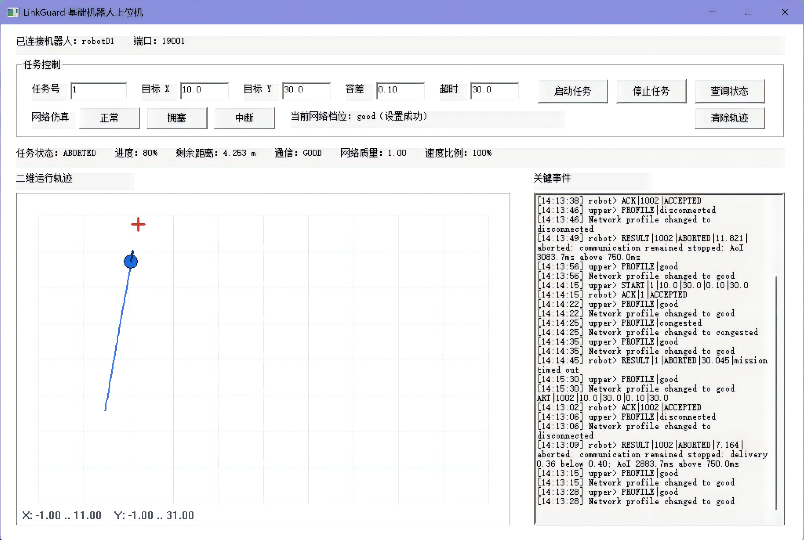
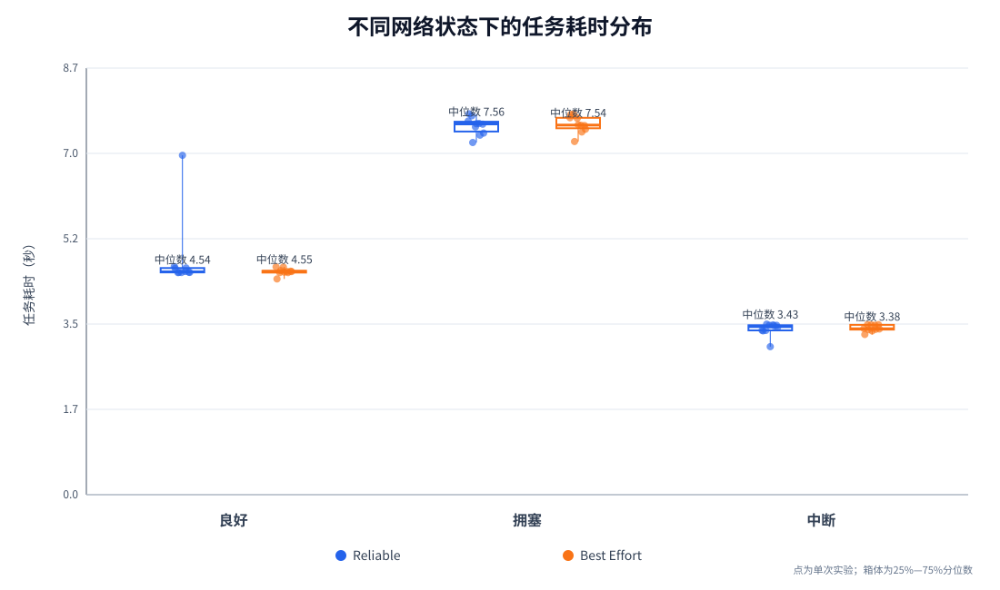
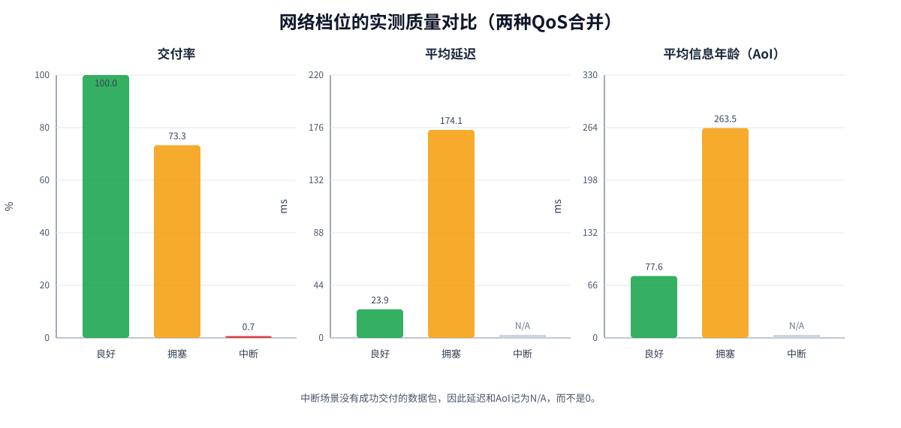
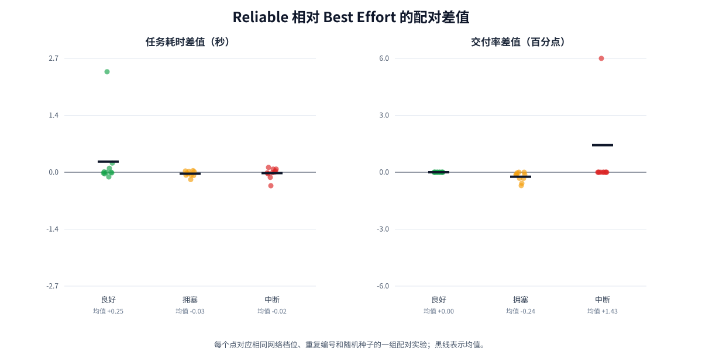
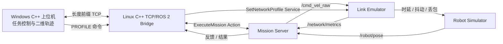

# LinkGuard：面向弱网环境的 ROS 2 机器人任务系统

LinkGuard 是一个跨 Windows 与 Linux 的机器人通信项目。Windows 上位机负责下发任务和显示二维运动轨迹，Linux 端运行 ROS 2 机器人仿真；系统根据交付率、延迟、抖动和信息年龄判断通信状态，并在网络恶化时降速，在持续断网时安全停止任务。

项目重点不是实现复杂的路径规划，而是回答一个工程问题：**当机器人依赖网络执行远程任务时，通信变差后系统应该怎样继续运行或安全退出？**

## 演示效果

### Windows图形上位机



上位机通过TCP连接Linux机器人端，可下发目标位置、停止或查询任务，并切换正常、拥塞和中断三种网络档位。界面左侧实时绘制机器人当前位置、目标点和二维运行轨迹，右侧保留关键命令、网络切换和任务结果，便于观察弱网状态下的降速与安全中止过程。

| 网络状态 | 系统行为 | 实验结果 |
|---|---|---|
| 良好（good） | 机器人全速执行任务 | 20/20 次成功，中位耗时 4.55 秒 |
| 拥塞（congested） | 根据通信状态降速，继续完成任务 | 20/20 次成功，中位耗时 7.55 秒 |
| 中断（disconnected） | 停车并在保护窗口后中止任务 | 20/20 次按预期中止，STOPPED平均持续 2.03 秒 |

拥塞使任务耗时中位数增加约 66%，体现了安全性和执行效率之间的权衡。当前实验未观察到 Reliable 与 Best Effort 之间具有工程意义的差异，原因和实验边界见[实验结论](#实验结论与边界)。







## 系统架构



### Windows上位机

- 使用 C++17、WinSock 和 Win32/GDI，不要求在 Windows 安装 ROS 2；
- 监听 Linux 机器人主动发起的 TCP 连接；
- 下发目标坐标、查询状态、取消任务、切换网络档位；
- 绘制机器人当前位置、目标点和历史轨迹；
- 只显示关键事件，避免心跳和周期指标刷屏。

### Linux机器人端

- `linkguard_tcp_bridge`：把 TCP 命令转换为 ROS 2 Action和Service调用；
- `mission_server`：管理任务生命周期、反馈、取消、超时和通信安全策略；
- `link_emulator`：注入时延、抖动和应用层丢包，输出网络质量指标；
- `robot_sim`：执行二维运动学仿真，并通过命令看门狗避免失联后继续运动；
- `network_monitor`：用于调试和实验观察，可关闭周期日志。

## 关键设计

### 1. ROS 2通信机制分工

| 机制 | 用途 | 选择原因 |
|---|---|---|
| Topic | 位姿、速度命令、网络指标 | 连续、异步数据流 |
| Service | 切换网络配置 | 一次请求、一次确认 |
| Parameter | 阈值和节点启动配置 | 低频配置数据 |
| Action | 执行移动任务 | 支持反馈、取消和最终结果 |

### 2. TCP消息边界

TCP是字节流，程序不能假设一次`send`对应一次`recv`。项目使用：

```text
4字节网络字节序长度 + UTF-8消息正文
```

发送端和接收端都实现完整收发循环；Windows端通过统一发送锁避免心跳、命令和任务反馈交叉写入同一字节流。

### 3. 断线与任务语义

- Linux每2秒主动尝试重连Windows；
- TCP短暂断开不会自动取消正在执行的ROS 2任务；
- 重连后可用`STATUS`查询当前任务；
- 不自动重放未确认的`START`命令，避免任务被重复执行；
- 持续通信中断会进入`STOPPED`，超过保护窗口后Action返回`ABORTED`。

## TCP协议示例

Windows发送：

```text
START|1001|5.0|2.0|0.10|30.0
STATUS|1001
STOP|1001
PROFILE|congested
QUIT
```

Linux返回：

```text
ACK|1001|ACCEPTED
FEEDBACK|1001|42|3.117|0.950|DEGRADED|0.500|1.420|0.610
RESULT|1001|SUCCEEDED|12.430|target reached
ACK|1001|CANCEL_REQUESTED
```

协议和线程边界详见[`docs/TCP_ROS2_BRIDGE.md`](docs/TCP_ROS2_BRIDGE.md)。

## 仓库组成

该项目由两个配套工程组成：

```text
ros2_linkguard_project/             Linux ROS 2机器人端
├── linkguard_interfaces/           自定义msg、srv和action
├── linkguard_bringup/              仿真、链路模型、任务策略和实验工具
├── linkguard_tcp_bridge/           C++ TCP/ROS 2桥接节点
├── docs/                            协议、实验和项目说明
└── tools/                           实验绘图脚本

tcp_stream_lab/                     Windows C++上位机
├── apps/tcp_server_gui_win.cpp      图形化上位机
├── apps/tcp_server_win.cpp          控制台调试版本
└── CMakeLists.txt
```

## 环境

- Linux：Ubuntu 24.04、ROS 2 Jazzy、Python 3.12；
- Windows：Windows 10/11、Visual Studio C++工具链、CMake；
- 网络：Windows端开放TCP 19001，Linux能够访问Windows IPv4地址。

## 构建ROS 2工程

将`ros2_linkguard_project`放到工作空间的`src`目录：

```bash
mkdir -p ~/linkguard_ws/src
cd ~/linkguard_ws
source /opt/ros/jazzy/setup.bash
colcon build --symlink-install
source install/setup.bash
```

如果系统已经安装`rosdep`，可在构建前执行：

```bash
rosdep install --from-paths src --ignore-src -r -y
```

## 构建Windows上位机

在Developer PowerShell for Visual Studio中执行：

```powershell
cd C:\Users\16862\cpp_learning\tcp_stream_lab
cmake -S . -B build\windows -A x64
cmake --build build\windows --config Debug --target tcp_server_gui_win
```

## 运行跨设备演示

### 1. Windows启动图形上位机

```powershell
.\build\windows\Debug\tcp_server_gui_win.exe
```

上位机监听`0.0.0.0:19001`。图形版和控制台版使用相同端口，不能同时运行。

### 2. Linux启动ROS 2系统与桥接节点

```bash
cd ~/linkguard_ws
source /opt/ros/jazzy/setup.bash
source install/setup.bash
ros2 launch linkguard_tcp_bridge tcp_demo.launch.py \
  server_ip:=10.29.213.237 server_port:=19001
```

把示例IP替换为Windows当前可访问的IPv4地址。命令中不要输入`<`和`>`。

### 3. 推荐演示顺序

1. 在“正常”网络下启动任务，观察机器人到达目标；
2. 新任务执行中切换到“拥塞”，观察速度比例下降并继续完成；
3. 新任务执行中切换到“中断”，观察机器人停车并返回`ABORTED`；
4. 恢复“正常”，再次启动任务，验证系统能够继续工作；
5. 运行中点击“停止任务”，验证Action取消流程。

## 正式实验

定量实验在Linux单机环境运行，不需要启动Windows上位机。实验程序会自动启动和停止ROS 2节点，并记录每轮结果。

```bash
cd ~/linkguard_ws
source /opt/ros/jazzy/setup.bash
source install/setup.bash

ros2 run linkguard_bringup qos_experiment \
  --repetitions 10 \
  --profiles good congested disconnected \
  --reliabilities reliable best_effort \
  --qos-depth 10 \
  --target-x 2.0 --target-y 1.0 \
  --tolerance 0.10 --timeout 40 \
  --base-seed 2000 \
  --output experiments/results/formal_qos_trials.csv
```

本次正式数据共60轮：

```text
3种网络档位 × 2种QoS策略 × 10次重复 = 60轮
```

相同网络档位和重复编号使用相同随机种子，使Reliable与Best Effort能够配对比较。

## 绘制三张项目图

绘图脚本只使用Python标准库，不需要安装Matplotlib：

```bash
python3 tools/plot_formal_results.py \
  experiments/results/formal_qos_trials.csv \
  docs/images
```

输出：

```text
docs/images/mission_duration.svg       任务耗时分布与异常轮次
docs/images/network_quality.svg        交付率、延迟和AoI
docs/images/qos_paired_difference.svg  Reliable与Best Effort配对差值
```

三张图分别回答：

1. 网络恶化是否让任务执行变慢或中止？
2. 三种网络档位的实测质量差异有多大？
3. 在控制随机种子后，两种QoS策略是否仍有稳定差异？

## 实验结论与边界

- 良好和拥塞环境下40轮任务全部完成；
- 拥塞时平均交付率约73.3%，平均延迟约174 ms，任务中位耗时增加约66%；
- 中断环境下20轮任务全部按策略中止，未继续盲目运动；
- Reliable与Best Effort没有显示出稳定且具有工程意义的差异；
- 应用层`link_emulator`主动丢弃的消息无法由DDS Reliable恢复，因此本实验主要验证LinkGuard的自适应策略，不能替代真实网络中的DDS QoS基准测试；
- 中断场景没有成功交付的数据包，延迟、抖动和AoI应解释为“无有效样本”，而不是0 ms。

## 测试

```bash
cd ~/linkguard_ws
source /opt/ros/jazzy/setup.bash
source install/setup.bash
colcon test --packages-select linkguard_bringup
colcon test-result --verbose
```

测试覆盖序号跟踪、链路模型、交付指标、通信策略和实验分析。

## 已知限制

- 机器人使用二维运动学仿真，没有真实底盘、传感器噪声和路径规划；
- 网络损伤是应用层模拟，不等同于真实Wi-Fi、5G或受限带宽链路；
- 当前是单机器人、单任务模型；
- Windows GUI用于工程演示，正式量化结果来自Linux自动实验；
- 若要严格比较DDS QoS，需要跨主机或使用`tc netem`构造真实传输层拥塞。

## 项目状态

当前版本已经完成跨平台通信、ROS 2任务闭环、弱网自适应策略、图形化演示和60轮正式实验。后续工作以文档、演示视频和求职展示为主，不再继续扩大功能范围。

## License

Apache-2.0
