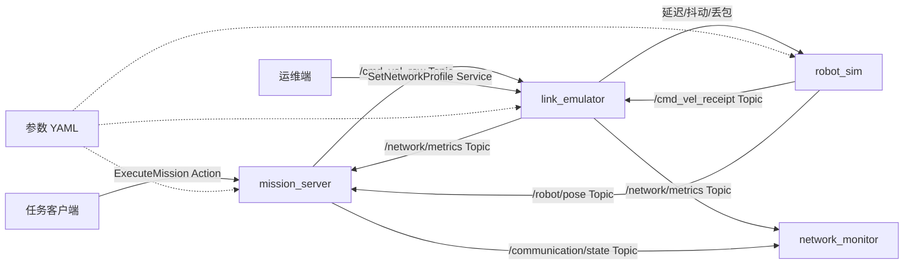

# LinkGuard：网络感知型 ROS 2 机器人任务系统

LinkGuard 是一个面向“通信 × 机器人”方向的作品集项目。它模拟机器人通过存在时延、抖动和丢包的链路接收速度指令，并让任务执行器根据实时链路质量完成、取消或中止导航任务。

这个项目刻意让 ROS 2 的四种核心通信机制各司其职：

| 机制 | 项目中的职责 | 为什么适合 |
|---|---|---|
| Topic | 带序号和时间戳的速度指令、位姿、网络指标 | 高频、异步、多消费者 |
| Service | 切换网络配置（良好/拥塞/断连/自定义） | 一次请求、一次响应 |
| Parameter | 节点启动配置与运行期调参 | 低频配置，不承担业务数据 |
| Action | 执行一个有时长、可反馈、可取消的移动任务 | 长任务，需要反馈和取消 |

## 系统架构



## 当前交付状态

- [x] D0：需求、架构、通信契约、验收标准
- [x] D1：单机器人通信闭环 MVP
- [x] D2.1：控制命令序号与时间戳
- [x] D2.2：滑动窗口交付率、实测延迟/抖动、AoI 与乱序统计
- [x] D2.3：实测指标驱动的 GOOD/DEGRADED/STOPPED/ABORTED 状态机
- [x] D2.4：显式 QoS、控制端/机器人端双容器通信
- [ ] D3：多机器人调度、故障恢复与生命周期管理
- [ ] D4：CI、Docker、性能报告、演示视频与作品集页面

详细路线见 [docs/DELIVERY_PLAN.md](docs/DELIVERY_PLAN.md)，第一周练习见 [docs/LEARNING_TASKS.md](docs/LEARNING_TASKS.md)，面试叙事见 [docs/PORTFOLIO_GUIDE.md](docs/PORTFOLIO_GUIDE.md)。

## 环境建议

- Ubuntu 24.04
- ROS 2 Jazzy
- Python 3.12

代码使用的 API 同样适用于较新的 ROS 2 发行版。若你使用 Humble（Ubuntu 22.04），建议先按当前版本尝试构建，再针对 Python API 的小差异调整。

## 构建

把整个目录放到工作空间的 `src` 下：

```bash
mkdir -p ~/linkguard_ws/src
cp -r ros2_linkguard_project/* ~/linkguard_ws/src/
cd ~/linkguard_ws
source /opt/ros/jazzy/setup.bash
rosdep install --from-paths src --ignore-src -r -y
colcon build --symlink-install
source install/setup.bash
```

## 运行第一阶段 Demo

终端 1：

```bash
ros2 launch linkguard_bringup demo.launch.py
```

终端 2：发送移动目标：

```bash
ros2 action send_goal /execute_mission linkguard_interfaces/action/ExecuteMission \
  "{target_x: 5.0, target_y: 2.0, tolerance: 0.10, max_duration_sec: 30.0}" --feedback
```

也可以使用附带的测试客户端，并在 3 秒后主动取消：

```bash
ros2 run linkguard_bringup mission_client --x 5 --y 2 --cancel-after 3
```

终端 3：任务进行中切换到拥塞网络：

```bash
ros2 service call /set_network_profile linkguard_interfaces/srv/SetNetworkProfile \
  "{profile: congested, latency_ms: 0.0, jitter_ms: 0.0, drop_rate: 0.0}"
```

恢复良好网络：

```bash
ros2 service call /set_network_profile linkguard_interfaces/srv/SetNetworkProfile \
  "{profile: good, latency_ms: 0.0, jitter_ms: 0.0, drop_rate: 0.0}"
```

自定义链路（`profile` 设为 `custom`）：

```bash
ros2 service call /set_network_profile linkguard_interfaces/srv/SetNetworkProfile \
  "{profile: custom, latency_ms: 180.0, jitter_ms: 40.0, drop_rate: 0.25}"
```

运行时策略参数调整示例：

```bash
ros2 param set /mission_server degraded_delivery_rate 0.80
ros2 param set /mission_server degraded_speed_scale 0.40
ros2 param get /link_emulator drop_rate
ros2 topic echo /network/metrics
ros2 topic echo /communication/state
```

查看D2控制报文和实测通信指标：

```bash
ros2 interface show linkguard_interfaces/msg/CommandPacket
ros2 interface show linkguard_interfaces/msg/CommandReceipt
ros2 topic echo /cmd_vel_raw --once
ros2 topic echo /cmd_vel --once
ros2 topic echo /cmd_vel_receipt --once
ros2 topic echo /network/metrics --once
```

`CommandPacket`中的`sequence`用于发现乱序，`stamp`用于测量实际延迟；机器人
实际收到命令后通过`CommandReceipt`返回序号和接收时间。
`/network/metrics`同时保留配置值，并发布最近50个已完成投递结果的交付率、
实际延迟、实际抖动、AoI和乱序数量。仍在延迟队列中的命令不会被提前算作丢包。

从D2.3开始，任务服务器不再根据配置的`drop_rate`直接判断安全状态，而是根据
上述实测指标进入`GOOD`、`DEGRADED`、`STOPPED`或`ABORTED`。拥塞时降低线速度，
危险链路下先停车，持续超过保护时限后再中止Action。

D2.4将命令Topic的reliability和depth显式化，并提供双容器部署。详细验收命令见
[docs/D2_3_D2_4_GUIDE.md](docs/D2_3_D2_4_GUIDE.md)。

## 第一次演示建议

1. 在 `good` 网络下发送 `(5, 2)` 目标，观察反馈和成功结果。
2. 再发送同一目标，中途切为 `congested`，观察收敛变慢和 delivery rate 下降。
3. 中途切为 `disconnected`，观察任务因链路质量不足而安全停车。
4. 取消一个正在执行的目标，证明 Action 的取消语义有效。

## 仓库结构

```text
ros2_linkguard_project/
├── linkguard_interfaces/     # CommandPacket、NetworkMetrics、srv、action
├── linkguard_bringup/        # Python 节点、launch、参数和单元测试
├── docker/                   # 容器镜像入口
├── docker-compose.yml        # 控制端与机器人端双容器编排
└── docs/                     # 架构、交付计划、验收与面试说明
```

## 你应该亲自完成的部分

第一阶段代码已经给你一个正确起点，但作品集的价值来自你能解释和扩展它。建议先不要直接进入多机器人：先画出数据流，逐个运行节点，用 `ros2 topic/service/action/param` 命令验证每条通信链路，并把你观察到的现象写进实验记录。
