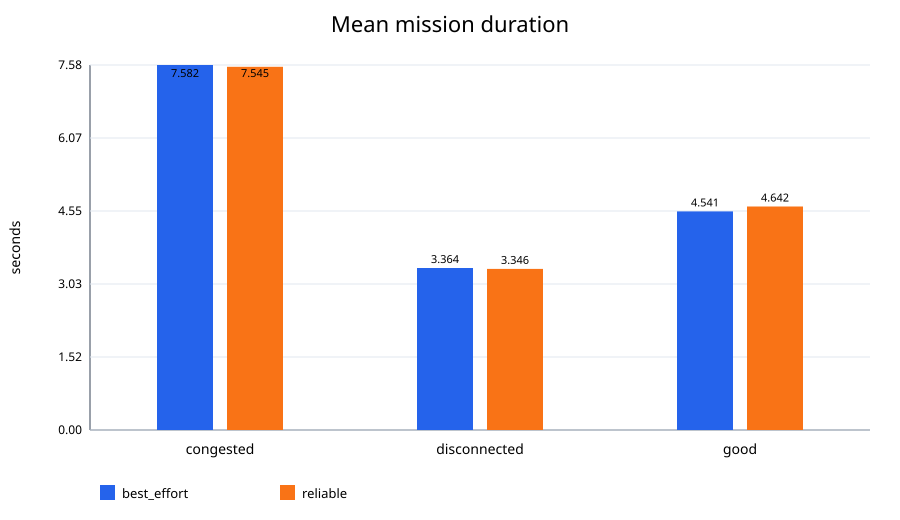
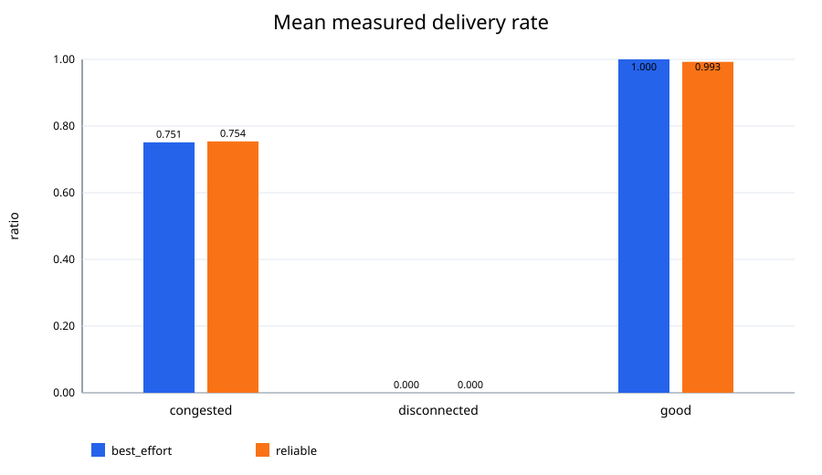
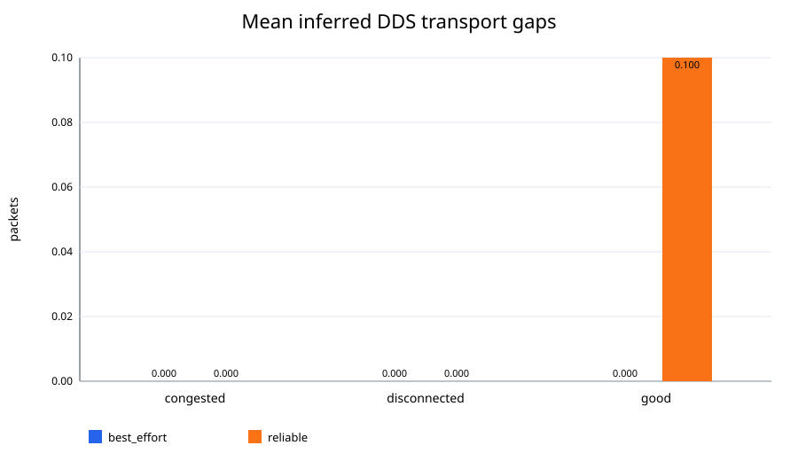
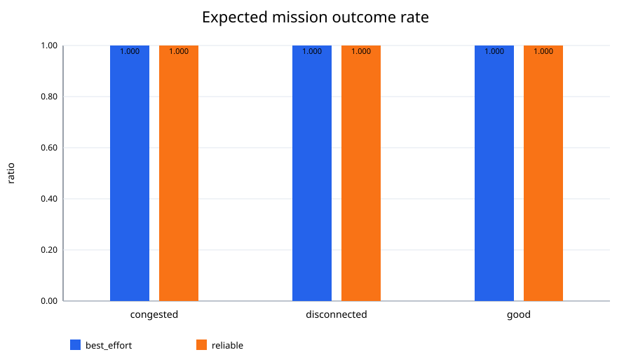

# LinkGuard QoS重复对照实验报告

- 生成时间：2026-09-28T06:37:24.766642+00:00
- 原始数据：`qos_trials.csv`
- 原始记录数：60
- 对照变量：命令Topic reliability（RELIABLE / BEST_EFFORT）
- 控制变量：相同目标、QoS depth、网络profile，以及配对随机种子

## 汇总结果

| QoS | 场景 | 有效/总次数 | 成功率 | 预期结果率 | 任务耗时均值±标准差(s) | 交付率均值±标准差 | 延迟(ms) | 抖动(ms) | DDS缺口均值 |
|---|---:|---:|---:|---:|---:|---:|---:|---:|---:|
| best_effort | congested | 10/10 | 1.000 | 1.000 | 7.582 ± 0.159 | 0.751 ± 0.069 | 183.9 | 53.4 | 0.00 |
| best_effort | disconnected | 10/10 | 0.000 | 1.000 | 3.364 ± 0.044 | 0.000 ± 0.000 | 0.0 | 0.0 | 0.00 |
| best_effort | good | 10/10 | 1.000 | 1.000 | 4.541 ± 0.038 | 1.000 ± 0.000 | 23.3 | 4.3 | 0.00 |
| reliable | congested | 10/10 | 1.000 | 1.000 | 7.545 ± 0.136 | 0.754 ± 0.066 | 187.5 | 55.7 | 0.00 |
| reliable | disconnected | 10/10 | 0.000 | 1.000 | 3.346 ± 0.066 | 0.000 ± 0.000 | 0.0 | 0.0 | 0.00 |
| reliable | good | 10/10 | 1.000 | 1.000 | 4.642 ± 0.260 | 0.993 ± 0.023 | 24.7 | 8.0 | 0.10 |

## 图表









## 自动生成的观察

- `congested`：RELIABLE相对BEST_EFFORT的平均交付率差值为+0.003，任务耗时差值为-0.037s。
- `disconnected`：RELIABLE相对BEST_EFFORT的平均交付率差值为+0.000，任务耗时差值为-0.018s。
- `good`：RELIABLE相对BEST_EFFORT的平均交付率差值为-0.007，任务耗时差值为+0.101s。

## 结论边界

- 本次记录中有 `0` 次实验基础设施错误；这些行未进入指标均值。
- `disconnected`场景的预期结果是Action中止，因此成功率为0不代表测试失败；应查看“预期结果率”。
- 应用层`drop_rate`发生在link_emulator内部，RELIABLE不会恢复模拟器主动丢弃的报文。
- 单机环境中的DDS链路通常非常稳定；若两种QoS差异很小，这是合理结果，不应夸大结论。
- 真正评价QoS抗拥塞能力，还需要受控带宽、CPU压力或跨主机网络实验。

## 可复现命令

```bash
ros2 run linkguard_bringup qos_experiment --repetitions 10
ros2 run linkguard_bringup qos_analyze \
  --input experiments/results/qos_trials.csv \
  --output-dir experiments/results/report
```
